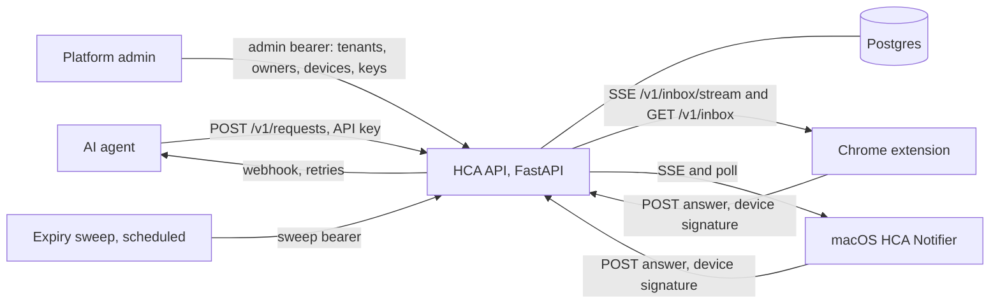
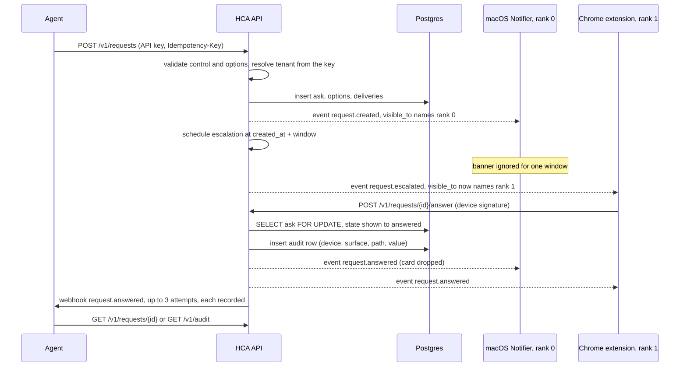

# HCA architecture

## Overview

HCA is one FastAPI service in front of Postgres. Agents talk to it with API keys, humans talk to it through devices (a Chrome extension and a macOS menu bar app) that sign every call with a device key. The service owns the question lifecycle: validation, tenant scoping, surface routing, a single terminal transition per ask, the audit record and delivery of the answer back to the agent by webhook. Clients are thin: they render what the server says they may see and post signed answers.

## One ask, end to end

## Components

| Module | Responsibility |
| --- | --- |
| `api/app/main.py` | Application assembly: routers for requests, audit, inbox, api keys, sweep, devices, tenants, privacy |
| `api/app/requests_api.py` | Create, read, answer, cancel; row locking; terminal transition rule |
| `api/app/controls.py` | Control catalogue (`approve_deny`, `radio`, `dropdown`, `checkbox`, `chat`, `confirm_rows`), size bounds, answer value validation, `GET /v1/controls` |
| `api/app/inbox_api.py` | `GET /v1/inbox` and `GET /v1/inbox/stream` (server-sent events), filtered per device and tenant |
| `api/app/routing.py` | Surface ladder: eligible devices, rank, visibility windows, escalation timers |
| `api/app/events.py` | In-process event bus; event types `request.created`, `request.escalated`, `request.answered`, `request.cancelled`, `request.expired`; `visible_to` device lists |
| `api/app/expiry.py` | Deadline sweep: auto deny, expire or hold per `expiry_policy`; idempotency table cleanup |
| `api/app/webhooks.py` | Delivery to the agent's callback with retries and one `webhook_attempts` row per attempt |
| `api/app/idempotency.py` | `Idempotency-Key` replay store, 24 hour TTL by default |
| `api/app/auth.py` | `require_agent_key`, `require_admin_bearer`, `require_device`, `require_linked_device` |
| `api/app/devicesig.py` | Device signature contract: canonical string, P-256 verification, timestamp freshness, device id derivation |
| `api/app/googleauth.py` | Google ID token verification for the owner link |
| `api/app/tenancy.py` | Tenant and tenant owner administration routes |
| `api/app/apikeys.py`, `apikeys_api.py` | Key format `hca_live_<prefix>_<secret>`, hashing, issue, list, revoke |
| `api/app/devices_api.py` | Device registration, self view, priority, Google link, revoke |
| `api/app/sweep_api.py` | `POST /expiry-sweep` behind its own bearer, called on a schedule |
| `api/app/privacy.py` | `GET /privacy`, the page the Chrome Web Store listing points to |
| `api/app/models.py`, `api/alembic/` | SQLAlchemy models and migrations; `scripts/check_migrated.py` asserts head after upgrade |
| `extension/` | Manifest V3 extension: `background.js` (stream, poll, offline queue), `popup.js`, `options.js`, `lib/devicekey.js`, `lib/api.js`, `lib/hostaccess.js` |
| `macos/` | `HCACore` (signing, API client, routing rules, tests) and `HCANotifier` (menu bar app, banners, launch at login) |

## Data model

| Table | Purpose |
| --- | --- |
| `tenants` | One row per tenant; `disabled_at` blocks every route for that tenant |
| `tenant_owners` | Google account emails allowed to link a device for the tenant |
| `asks` | The question: caller, tenant, control, title, why, deadline, `expiry_policy`, `red_gate`, `state`, timestamps |
| `options` | Options of an ask (id, label, description, order) |
| `deliveries` | Which surface received the ask and when |
| `api_keys` | Caller, tenant, prefix, secret hash, revoked_at; one live key per caller |
| `audit_rows` | The answer record: ask, device, surface, path, value, answered_at |
| `idempotency_keys` | Tenant, scope, route, key, body hash, stored response, expiry |
| `webhook_attempts` | One row per HTTP attempt: ask, event, url, attempt number, status or error, ok flag |
| `devices` | Device id (derived from the public key), label, surface, public key PEM, priority, Google link, last seen, revoked_at, tenant |

Every tenant-owned table carries `tenant_id`; queries take the tenant from the authenticated key or device, never from the request body.

## Request state machine

States are strings on `asks.state`, typed as `queued`, `shown`, `answered`, `expired`, `withdrawn`, `cancelled` (`schemas.py`). A new ask starts `queued`; `queued` and `shown` are the pending states the inbox lists. The terminal set is `{"answered", "expired", "withdrawn", "cancelled"}` (`requests_api.py`). Transitions:

- pending to `answered`: `POST /v1/requests/{id}/answer` by a linked device that may see the ask, value valid for the control.
- pending to `cancelled`: `POST /v1/requests/{id}/cancel` by the owning agent with a reason.
- pending at the deadline, by the sweep, per `expiry_policy`: `auto_deny` (default) writes a deny answer and the ask becomes `answered`; `expire` makes it `expired`; `hold` leaves it pending and records the hold.

Each transition loads the row with `SELECT ... FOR UPDATE`, re-checks that the state is still non-terminal inside the lock, and refuses a second terminal transition with a conflict response. A retried answer with the same `Idempotency-Key` returns the stored first response without a second decision.

## Surface routing

From `routing.py`: devices eligible for an ask are the tenant's non-revoked, Google-linked devices seen within `DEFAULT_ACTIVE_SECONDS` (600). They are ranked by `priority` (lower first; the Notifier runs at 10, the Chrome device at 200 in the reference setup). An ask is visible to rank *r* from `created_at + r * window`, where the window is `DEFAULT_FALLBACK_SECONDS` (90) or half that for a red gate. At each boundary the server publishes `request.escalated` with the enlarged `visible_to` list. Clients ignore envelopes that do not name them; the inbox applies the same filter server side, so a client cannot read ahead of its rank. The Mac app re-posts banners the owner swipes away until the ask is answered.

## Idempotency and concurrency

`Idempotency-Key` (any string up to 200 characters) is scoped to tenant, caller scope and route; the same key with a different body is refused with 422. Stored responses expire after `HCA_IDEMPOTENCY_TTL_SECONDS` (default 24 hours) and are swept with expiry. Answers and cancellations take the row lock; the Postgres threaded tests race two writers and assert exactly one wins. Device sessions do not expire objects after commit, so long-lived streams never hold an idle transaction open.

## Operations

- **Pipeline** (`cloudbuild.yaml`): guard, pytest, smoke-local, pack-extension, build, push, migrate, deploy, smoke-live. The migrate step runs `alembic upgrade head` as a Cloud Run job and then `scripts/check_migrated.py`, which fails the build unless the database reports the expected head and every model table exists. A green step status is never read as proof; the job's own log and the live revision are.
- **Smoke-live** (`scripts/`): mints a key, posts an ask, answers it with a test device, reads audit and webhook, revokes the key.
- **Configuration**: all by environment variables and Secret Manager (database URL, admin bearer, sweep bearer, api key pepper HCA_API_KEY_PEPPER, Google client ids, owner allowlist fallback, webhook retry settings, idempotency TTL, connection pool bounds HCA_DB_POOL_SIZE 3, HCA_DB_MAX_OVERFLOW 3, HCA_DB_POOL_TIMEOUT 10, HCA_DB_POOL_RECYCLE 300, sized for a 25 slot database). No project id or hostname is committed.
- **Records**: every deploy and every proof has a dated file under `docs/deploys/`; every design decision and the alternatives declined under `docs/decisions/`.

## Roadmap

The hardening program (P19 to P27) is in `docs/plans/HCA_P19_PRODUCTION_HARDENING_PROGRAM_v1.md`: durable delivery with an events table and replay, webhook and auth hardening, work orders and connectors, extension and macOS hardening and release path, container and CI hardening, bootstrap isolation, documentation and policy.
