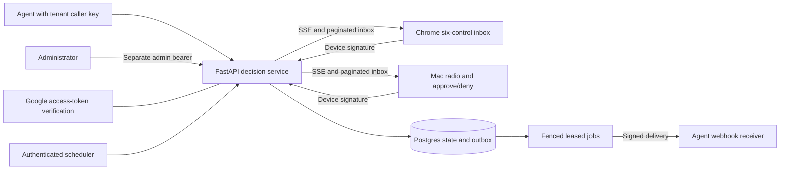
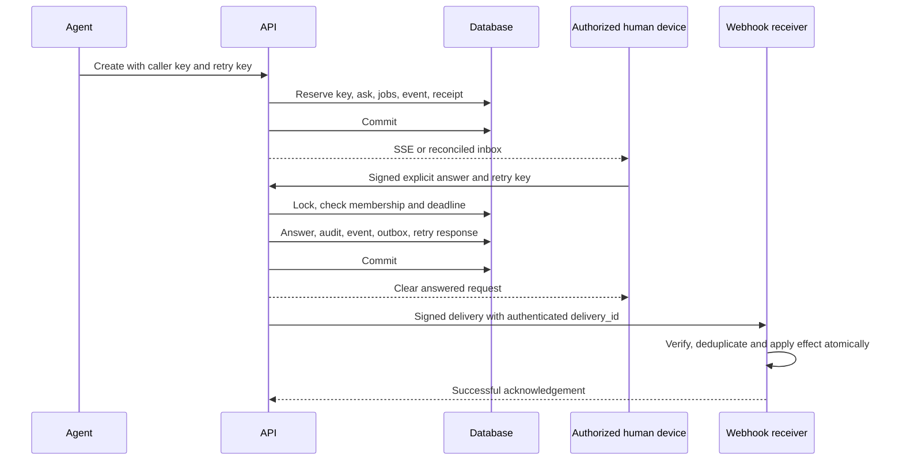

# Architecture

HCA separates agent credentials, human device authorization and platform administration. FastAPI owns validation and the decision lifecycle; Postgres owns durable state. Chrome provides the complete decision UI. The Mac developer client provides radio and approve/deny decisions and directs other controls to Chrome.

The supported audience is current tenant owners. `audience` is descriptive metadata, not a role or department authorization rule. Work-order orchestration, enterprise connectors, voice interaction and broader role-based audiences remain outside the implemented scope.

## A decision transaction

An agent submits a request with its API key and an optional `Idempotency-Key`. The service resolves caller/tenant from that key, validates the control and payload limits, checks the tenant's active-request ceiling, resolves a registered webhook destination when applicable, and reserves the idempotency key under a database uniqueness constraint.

The create transaction writes the ask, options, scheduled jobs, event and stored retry response. An answer or cancellation loads the ask under a row lock, rechecks state and authorization, and writes its terminal transition, audit, event, webhook delivery/job and idempotency response together. A failure before commit rolls back the group. Event dispatch is woken after commit, with database polling as recovery.

The retry fingerprint binds the body to the canonical operation/resource. A key reused for a different request does not return the first request's answer. A concurrent duplicate create waits on the same reservation and receives the committed receipt. Idempotency responses have a bounded lifetime; callers must not treat the retry store as a permanent external-effect ledger.

## State and expiry

Requests begin pending (`queued`, with `shown` also recognized). Answered, cancelled, expired and withdrawn states are terminal. A second terminal transition conflicts unless it is a valid idempotent replay.

`auto_deny` applies the configured deny result, `expire` closes without a human answer, and `hold` deliberately leaves the request answerable after its deadline. The answer transaction applies/rejects overdue non-hold requests before accepting the submitted value. Expiry correctness therefore does not depend on a background worker being timely. Held requests do not generate an endless chain of reconciliation jobs. Material red-gate requests use the enforced expiry policy documented by the API.

## Authorization and audit

Agents use tenant/caller API keys stored as HMAC-SHA256 hashes. Humans register a P-256 public key, sign each protected call, and link a Google access token whose verified account and OAuth audience are permitted. Production startup requires that link gate. Current membership, device revocation and tenant disablement are checked on protected calls and periodically on streams, including when events arrive continuously.

Audit owner, role, device and surface come from verified server state. Client-reported path, duration, optional context and identity claims are retained only as untrusted metadata. This records the authenticated responder; it does not verify the truth of the agent's proposed command or that a webhook receiver performed the described action.

## Events, replay and routing

Events are durable rows written with state changes. Postgres uses LISTEN/NOTIFY for wake-up and a polling fallback for recovery. Event insertion acquires a transaction-scoped ordering lock so a later sequence ID cannot commit first and advance the dispatch cursor past an earlier uncommitted event. That global insertion serialization is a correctness/throughput tradeoff that requires load measurement for a larger deployment. SQLite remains a local demonstration and unit-test path.

The routing ladder ranks eligible owner devices by configured priority and recent activity. Visibility expands at successive fallback windows (90 seconds by default, 45 for material red gates). It provides presentation timing within a tenant, not authorization for separate organizational audiences.

Replay defaults to 24 hours and at most 1,000 scanned events. A future, expired or truncated cursor produces `stream.reset`; a full local subscriber queue also asks the client to reconcile. Chrome clears its scoped cursor, reconciles the paginated inbox and reconnects. Both clients poll as a recovery path. Stream revocation is rechecked on the server's elapsed interval (15 seconds by default), subject to normal server scheduling and database availability. The per-device local stream cap is per API process; an operator must also bound instances and edge concurrency.

## Workers and external delivery

Expiry, escalation and webhook jobs live in the database. Workers claim work near execution, renew leases for long operations, and condition mutations on their owner/generation. Losing a lease prevents stale database completion writes. A network request that already reached a receiver can still have an effect, so a lease is not an exactly-once external-delivery guarantee.

Webhook I/O occurs outside the business transaction. A bounded wall-clock deadline covers DNS and network work, redirects are refused, and the client does not consume an unlimited response. The signed body includes the delivery ID; the receiver must compare it with the header and atomically deduplicate effects. Read [the receiver contract](webhooks.md) for retries, rotation and dead deliveries.

## Data and implementation map

| Component | Main source | Responsibility |
| --- | --- | --- |
| Assembly/lifecycle | `api/app/main.py`, `config.py` | Routers, explicit production validation, worker/listener startup and shutdown |
| Decision model | `requests_api.py`, `controls.py`, `schemas.py` | Tenant/caller boundaries, limits, value validation, transitions and audit |
| Authentication | `auth.py`, `devicesig.py`, `nonces.py`, `googleauth.py`, `tenancy.py` | Signatures, replay, current owner membership and administration |
| Durable delivery | `events.py`, `jobs.py`, `routing.py`, `expiry.py` | Event ordering/replay, fenced work, presentation ladder and expiry |
| Webhook boundary | `webhooks.py`, `ssrf.py`, `webhook_destinations.py`, `webhook_crypto.py` | Registered URLs, checked DNS/address pinning, signatures, encryption and retries |
| Resource/lifecycle limits | `middleware.py`, `limits.py`, `retention.py`, `data_api.py` | Body/rate limits, bounded cleanup and tenant export/purge |
| Schema/storage | `models.py`, `api/alembic/` | Tenant-owned records, constraints and migrations |
| Complete browser UI | `extension/` | Non-extractable keys, scoped state, durable bounded queue, explicit decisions |
| Mac developer UI | `macos/` | Keychain signing, two controls, bounded OAuth callback, notification recovery |

The primary records are tenants/owners, agent keys, devices, asks/options, audit rows, durable events, scheduled jobs, idempotency responses, webhook destinations/deliveries/attempts and rate buckets. Tenant authorization is derived from credentials. Administrators can export records in bounded pages and explicitly purge completed records; transient events and completed jobs have bounded cleanup. Backup/log/profile retention remains an operator obligation.

## Limits and verification

Default limits include a 1 MiB request body, bounded nested data (depth 12 and 10,000 nodes), 1,000 active requests per tenant, 50 options for normal selection controls, 500 confirm rows, and 4,000 chat characters. Actor/tenant fixed-window budgets are shared through the database; responses include retry guidance. Inbox/audit/export pages default to 200 records, cap at 500 and use `X-HCA-Next-Cursor` with an `after` parameter. These are enforced bounds, not measured throughput promises.

The entire saved OpenAPI document is compared with FastAPI's generated definition, including schemas, constraints, security and headers. API fault/concurrency tests, real HTTP/SSE and two-process tests, Chromium DOM/IndexedDB tests, and Swift loopback tests exercise different boundaries. Postgres-specific checks need Postgres; real Google sign-in, operating-system behavior, IAM, restore and load tests require separate evidence. See [Contributing](../CONTRIBUTING.md), [Threat model](THREAT_MODEL.md) and [Operations](OPERATIONS.md).
