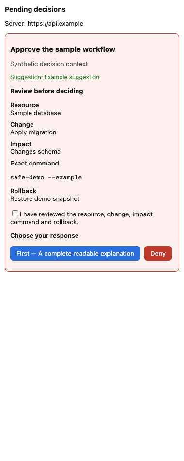

# Case study: an auditable human decision boundary

An autonomous workflow sometimes needs a human to approve a proposed change,
choose an option or confirm rows before continuing. HCA provides the visible
request, authorized response, durable audit and callback contract. It demonstrates
an API/database boundary, two clients, durable events/jobs and an external receiver.

The runnable scope is current tenant owners. Chrome answers all six supported
controls; the developer Mac client answers radio and approve/deny and directs
other decisions to Chrome. Enterprise connectors, arbitrary organizational roles
and public notarized Mac distribution are outside this demonstration.

## Five-minute review path

1. Follow [the root setup](../README.md#run-the-demonstration), then run
   `python scripts/demo_workflow.py`.
2. Inspect its synthetic request, independently device-signed answer,
   authenticated callback, committed mock effect, audit and safe retries. The
   script starts its own loopback API/receiver and needs no existing credentials.
3. Read [Architecture](ARCHITECTURE.md) and [current evidence](STATUS.md), then
   inspect the API transaction, stream, job and receiver regression suites.
4. Read the [Chrome](../extension/README.md) and [Mac](../macos/README.md)
   instructions before assessing platform or production claims.

This screenshot comes from the actual popup integration check using synthetic
data. It shows resource, proposed change, impact, command, rollback and an explicit
review acknowledgement. It is not a production deployment screenshot.

## Design choices and tradeoffs

| Choice | Result | Tradeoff |
| --- | --- | --- |
| Commit state, audit, event, outbox and retry result together | A crash cannot leave a partially recorded decision | Larger transactions and careful lock ordering |
| Resource-bound retry reservations | A key cannot replay a different ask; concurrent retries share one result | Bounded retry lifetime; external effects need their own ledger |
| Current membership and signed device calls | Owner removal invalidates existing devices; replay is bounded | Correct clocks and trusted browser/OS remain necessary |
| Ordered durable events plus reset/poll recovery | Reconnect and delayed commits do not silently skip pending asks | Global event insertion serialization requires load measurement |
| Fenced leases and signed receiver deduplication | Stale workers cannot overwrite successors; repeated delivery can be safe | Network delivery remains at least once and can fail dead |
| Complete Chrome surface, narrower Mac scope | Every supported API control has a usable client | Some Mac decisions require Chrome |
| Full API contract parity and independent integration layers | Schema/security drift is caught at reviewable boundaries | Tool success has a defined scope and requires exact-revision evidence |

Useful source entry points are `api/app/requests_api.py`, `idempotency.py`,
`events.py`, `jobs.py`, `auth.py`, `webhooks.py`, `extension/background.js`,
`extension/lib/devicekey.js` and their corresponding regressions. The demo's
receiver stores its effect and delivery ID in one SQLite transaction; a real
receiver must provide the same atomicity for its own business effect.

## Attribution and measured evidence

Existing commits and PRs record the project's history. The remediation used Codex
assistance, targeted failure probes, source review and regression checks. The
maintainer remains responsible for reviewing the implementation and claims.
The [status page](STATUS.md) links dated Postgres, client and manual-validation
evidence and distinguishes it from live infrastructure evidence.

A factual maintainer-written account of personal design, implementation and review
contributions, with commit/PR links, is still needed. This document does not invent
authorship, customer use, financial savings, throughput or production results.
The synthetic demonstration and screenshot show a complete supported workflow;
production sign-in, deployment, recovery and load claims require their own evidence.
